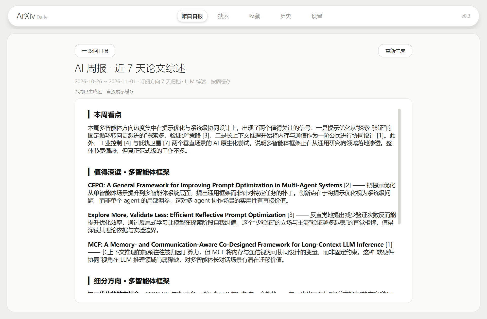
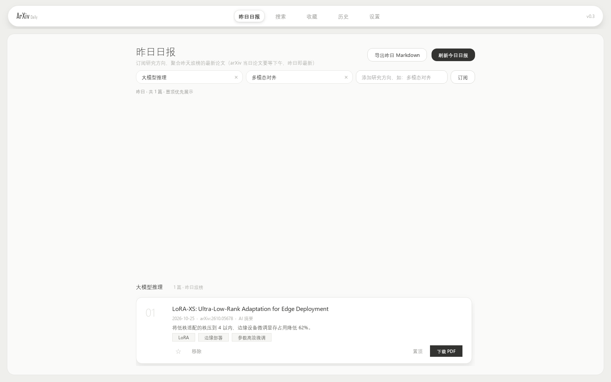
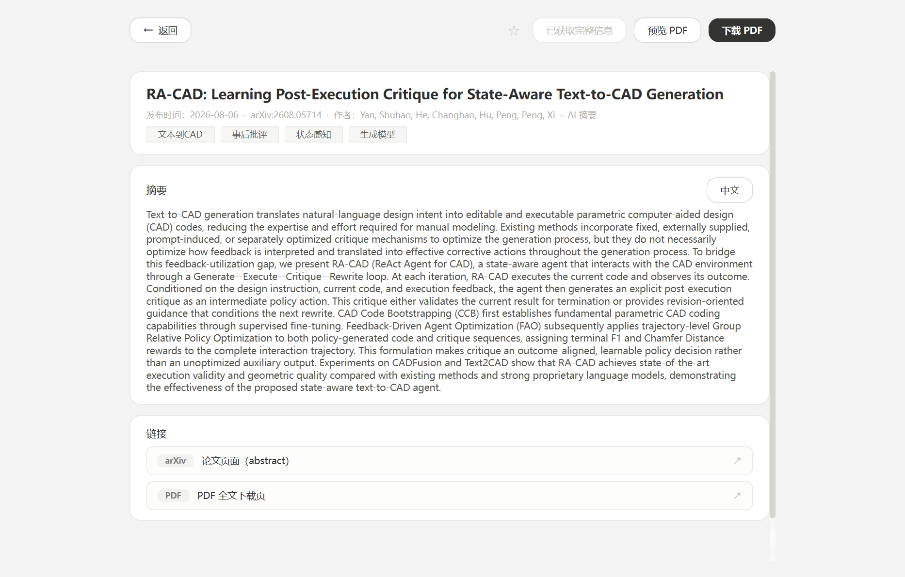
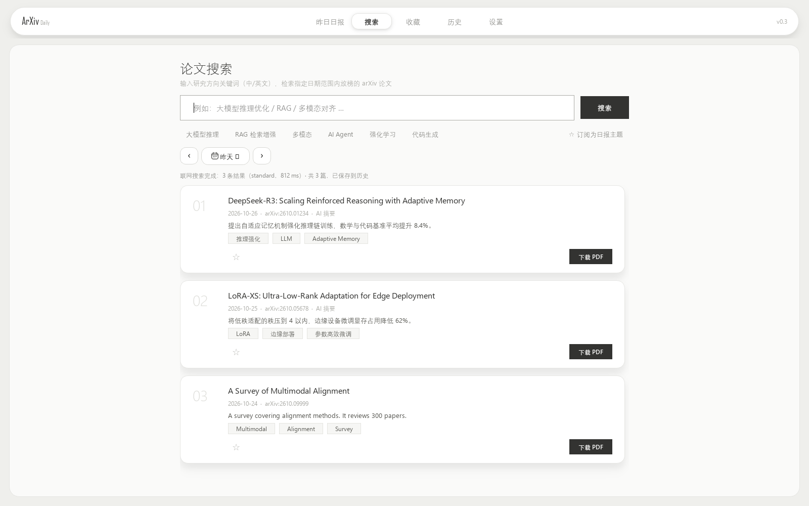
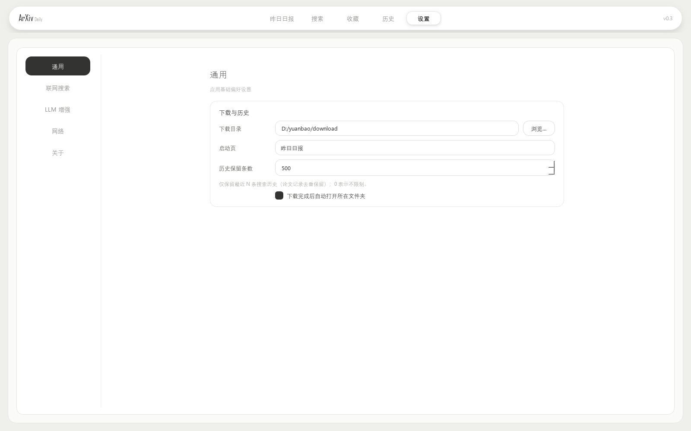

<div align="center">

# ArXiv Daily · 昨日论文日报

**一款嵌套圆角矩形设计的 arXiv 论文日报桌面应用**

订阅研究方向 → 每日聚合 → 中文摘要 → 全网解读 → 收藏导出

`Python` · `PySide6` · `LangGraph` · `元宝搜索 API`

</div>

---

## ✨ 功能特性

- **昨日日报（首页）**：订阅若干研究方向（中文即可），一键刷新聚合昨天放榜的各方向新论文（元宝搜索 `Freshness=昨日`），按主题分组展示，一键导出昨日 Markdown 日报
- **AI 周报**：近 7 天日报归档交给 LLM 写研究者视角综述——本周看点、值得深读（含创新点判断）、细分方向聚类，生成一次即缓存


- **方向搜索**：中/英文关键词 → LLM 规划英文检索式 → 元宝搜索（`Site=arxiv.org + Industry=acad`）→ 论文卡片；快捷方向 chips；「订阅为日报主题」
- **LLM 增强（可选）**：检索词规划 + 逐篇中文一句话摘要与关键词气泡；未配置自动降级（搜索摘要兜底）
- **论文卡片**：标题 / 日期 / 一句话摘要 / 关键词气泡 / ☆收藏 / 下载 PDF
- **论文详情**：完整元信息；「获取完整信息」直连 arxiv.org 补全（免费不占配额）；**代码仓库发现**（换 Site 参数一键变 GitHub 搜索，定位官方实现）；**PDF 应用内预览**
- **收藏**：星标集中管理，导出 BibTeX（文献管理）/ Markdown
- **历史**：每次搜索按日落库（本机 SQLite），逐行回看/删除
- **细致的设置**：启动页选择、下载目录与打开方式、历史保留条数；搜索参数（条数/模式/信源/站点/arXiv 过滤/自动放宽/是否记入历史）；LLM 细分控制（检索词规划独立开关、摘要篇数上限、温度/语言）；网络（代理、直连 arxiv.org 开关）；密钥密码态+显示切换、一键测试连接、即改即存
- **设计**：嵌套圆角矩形体系——暖灰画布 → 白色面板 → 白卡片 → 边线输入框；全灰阶无纯黑纯白；顶栏分段导航滑块动画 + 页面淡入
- **开源安全**：仓库零密钥，所有 Key 仅存本机 `~/.arxiv_daily/settings.json`

## 🖼 应用截图

| 今日日报 | 论文详情 |
| --- | --- |
|  |  |

| 搜索 | 设置 |
| --- | --- |
|  |  |

> 离屏渲染截图，本地运行效果更佳。

## 🚀 快速开始

```bash
git clone <repo-url> arxiv-daily
cd arxiv-daily
python -m venv .venv
# Windows
.venv\Scripts\pip install -r requirements.txt
.venv\Scripts\python main.py
# macOS / Linux
.venv/bin/pip install -r requirements.txt
.venv/bin/python main.py
```

> 国内网络建议 `-i https://pypi.tuna.tsinghua.edu.cn/simple`。
> **Anaconda 用户**：conda 自带 Qt 可能与 pip 的 PySide6 冲突，请用独立 venv；开发环境使用 `PySide6==6.9.2`。

### 配置（全部在应用内）

1. **设置 → 联网搜索**：腾讯云控制台 → 元宝搜索 →「概览 → 服务 API KEY 方式」→ 创建 API KEY（`sk-` 开头）→ 粘贴 → 测试连接
2. （可选）**设置 → LLM 增强**：任意 OpenAI 兼容接口，可拉取模型列表并测试
3. 回到「日报」订阅方向 / 「搜索」直接检索

## 🧠 架构

```
arxiv_daily/
├── config/     设置（~/.arxiv_daily/settings.json）
├── search/     元宝搜索 Provider（SearchPro；Mode=0 复用于全网解读）
├── llm/        OpenAI 兼容客户端
├── core/       LangGraph 流水线 plan→search→extract→enrich→persist
├── storage/    SQLite（searches/papers/topics/starred）
├── services/   digest 日报编排 · library 收藏导出 · insights 全网解读
├── fetcher/    直连 arxiv.org 解析 citation_* 补全详情
├── workers.py  QThread 封装（搜索/日报/解读/抓取/下载）
└── ui/         components + views（日报/搜索/收藏/历史/详情/设置）
```

调研依据与需求分析见 [docs/调研与需求分析.md](docs/调研与需求分析.md)。

## 📦 打包为 Windows exe（免命令行）

```bash
.venv\Scripts\pip install pyinstaller pillow
.venv\Scripts\python -m PyInstaller --onefile --windowed --name ArXivDaily ^
  --icon build/app.ico --add-data "arxiv_daily/ui/style.qss;arxiv_daily/ui" main.py
```

产物为 `dist/ArXivDaily.exe`（约 70MB，单文件免安装；首次启动需解压数秒）。
数据仍保存在 `~/.arxiv_daily/`，与源码运行完全共用。崩溃日志：`~/.arxiv_daily/crash.log`。

## 🧪 开发

```bash
python -m pytest          # 35 项离线单测（Mock 搜索，无需 Key）
QT_QPA_PLATFORM=offscreen python scripts/smoke_test.py   # 离屏 UI 冒烟 + 截图
```

## 📄 许可

[MIT](LICENSE) · 论文发现：[元宝搜索（腾讯云 wsa）](https://cloud.tencent.com/product/wsa) · 详情/PDF：[arXiv.org](https://arxiv.org) · 本项目参加「元宝搜索开发者征文大赛」
